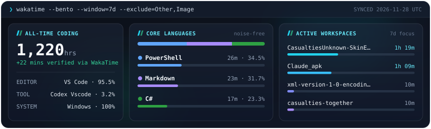
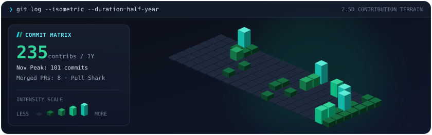

<picture>
  <source media="(prefers-color-scheme: dark)" srcset="https://raw.githubusercontent.com/huanxin886/huanxin886/output/hero-dark.svg" />
  <source media="(prefers-color-scheme: light)" srcset="https://raw.githubusercontent.com/huanxin886/huanxin886/output/hero-light.svg" />
  
</picture>

<picture>
  <source media="(prefers-color-scheme: dark)" srcset="https://raw.githubusercontent.com/huanxin886/huanxin886/output/waka-bento-dark.svg" />
  <source media="(prefers-color-scheme: light)" srcset="https://raw.githubusercontent.com/huanxin886/huanxin886/output/waka-bento-light.svg" />
  
</picture>

<picture>
  <source media="(prefers-color-scheme: dark)" srcset="https://raw.githubusercontent.com/huanxin886/huanxin886/output/contrib-3d-dark.svg" />
  <source media="(prefers-color-scheme: light)" srcset="https://raw.githubusercontent.com/huanxin886/huanxin886/output/contrib-3d-light.svg" />
  
</picture>

  

    
    
    
  

  

    
    
  

